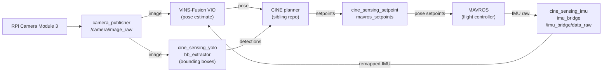

# CINE-Sensing

[](https://github.com/Kino-Studios/CINE-Sensing/actions/workflows/ci.yml)
[](LICENSE)
[](https://docs.ros.org/en/jazzy/)

A Raspberry Pi 5 bolted to a drone, running a camera and IMU, doing real-time visual-inertial odometry, YOLO subject detection, and flight-controller bridging on commodity ARM hardware. This is the sensing half of the Cinematic Intelligent Navigation Engine. The [CINE trajectory planner](https://github.com/Kino-Studios/CINE) is blind without it.

Four ROS 2 nodes handle the full perception loop: camera frames in, IMU axes reconciled with what VINS-Fusion expects, YOLO bounding boxes out, MAVROS setpoints in. Nothing exotic; no dedicated compute. The Pi is the point.

---

## Pipeline



---

## Supported platform

| | |
| --- | --- |
| OS / ROS | Ubuntu 24.04, ROS 2 Jazzy |
| Computer | Raspberry Pi 5 |
| Camera | Raspberry Pi Camera Module 3, published at 1152x648 |
| Flight controller | ArduPilot over MAVROS (`apm.launch`, serial `/dev/ttyAMA0` at 921600 baud; see `cine_sensing_imu/launch/start_mavros.sh`) |

---

## Install

**Requires:** Ubuntu 24.04 and ROS 2 Jazzy. VINS-Fusion needs Ceres Solver 2.1, which the
script below builds from source, because it uses an API that Ceres 2.2 (the Ubuntu 24.04
package) removed; see [`third_party/vins_fusion/UPSTREAM.md`](third_party/vins_fusion/UPSTREAM.md).

```bash
mkdir -p ~/cine_ws/src && cd ~/cine_ws/src
git clone https://github.com/Kino-Studios/CINE-Sensing.git
CINE-Sensing/tools/install_ceres_2_1.sh
source /opt/ros/jazzy/setup.bash
rosdep install --from-paths . -yi --rosdistro jazzy
sudo ros2 run mavros install_geographiclib_datasets.sh   # data MAVROS needs; rosdep cannot fetch it
pip install -r CINE-Sensing/requirements.txt
python3 CINE-Sensing/tools/download_assets.py
cd ~/cine_ws && colcon build --symlink-install
source ~/cine_ws/src/CINE-Sensing/source_env.sh
```

`tools/download_assets.py` fetches the files kept out of git from the GitHub Release
matching `VERSION`: the loop-closure vocabulary `brief_k10L6.bin`, the `global_fusion`
RViz meshes, and the camera-calibration images. It checks each file's SHA-256 and refuses
to overwrite a file that does not match. `--only <name>` fetches one file.

The YOLO detector loads the stock `yolo11n.pt` (COCO classes), which Ultralytics
downloads on first run, and keeps class 56 (chair). To use your own weights, put them in
`cine_sensing_yolo/models/` before building and set `MODEL_PATH` and `USER_OBJECT_ID` in
`cine_sensing_config/config/user_params.json`.

`source_env.sh` sources ROS 2 Jazzy and `~/cine_ws/install/setup.bash` (the workspace two
levels above the repository, or `$CINE_SENSING_WS`) and defaults `ROS_DOMAIN_ID` to 0.

---

## Run

```bash
# Camera
ros2 launch cine_sensing_camera camera.launch.py

# IMU bridge (axis-transform, publishes /imu_bridge/data_raw)
ros2 launch cine_sensing_imu imu_bridge.launch.py

# Gyroscope serial publisher + VIO relay
ros2 launch cine_sensing_imu imu_publisher.launch.py

# YOLO bounding-box extractor
ros2 run cine_sensing_yolo bb_extractor

# Full VIO stack (MAVROS + IMU bridge + camera + VINS + loop fusion)
ros2 launch vins complete_vio.launch.py
ros2 launch vins complete_vio.launch.py profile:=rpi_v3_tune_maxcnt250   # with a profile
# Options: vins_start_delay:=5.0 (seconds before VINS starts), use_transform:=false
# (IMU axis remap in imu_bridge; unvalidated, see the open issue below)

# Setpoint processor (bridges CINE setpoints to MAVROS)
ros2 run cine_sensing_setpoint mavros_setpoints
```

---

## Configuration

`cine_sensing_config/config/` holds the shared parameters (`camera.json`, `gyroscope.json`,
`user_params.json`, `vins.json`). Edit values there; do not hard-code paths or constants in
node source files. Nodes read the installed copy, so rebuild (or use `--symlink-install`)
after editing. The VINS YAML file is generated from `vins.json` on every VIO launch, so
edits to the generated file are lost.

### Profiles

A profile is a directory `cine_sensing_config/config/profiles/<name>/` holding a
`profile.json` and only the files it overrides. When a profile is active, each file it
holds replaces the base file of the same name as a whole (keys are not merged); every
other file comes from the base. Select one with the `profile:=<name>` launch argument
of `complete_vio.launch.py` and `replay_vio.launch.py`, or the `CINE_SENSING_PROFILE`
environment variable. With no profile, VINS reads the camera intrinsics in
`third_party/vins_fusion/config/rpi_camera_v3/cam0_wide.yaml`, as before profiles existed.

| Profile | Overrides | Status |
| --- | --- | --- |
| `rpi_v3_wide` | `vins_camera.json`: the `cam0_wide.yaml` intrinsics (fx 751) | uncalibrated-candidate |
| `rpi_v3_fullfov` | `vins_camera.json`: the 2025-10-31 checkerboard calibration in `tools/calibration/camera_calibration.yaml`, scaled from the full sensor resolution to 1152x648 (fx 497.6) | calibrated |
| `rpi_v3_tune_maxcnt250` | `vins.json`: hand-tuned feature tracking (max_cnt 250, min_dist 15, equalize 1, F_threshold 1.5, min_parallax 8) and a fixed time offset (estimate_td 0) | uncalibrated-candidate |

**Which camera intrinsics are correct is untested.** The two camera profiles disagree by
about 1.5x in focal length; which one matches the camera as it is actually driven at
1152x648 has not been checked on hardware. None of the profiles has been compared with
the base configuration on a recorded bag either; use `tools/vio_ab_run.sh` (below) for
that before adopting one.

To add a profile, create the directory, write a `profile.json` with `status`
(`calibrated` or `uncalibrated-candidate`), `source`, `notes` and, when known,
`reprojection_error_px`, and copy in only the files you change, complete. Camera values go
in `vins_camera.json`, using the keys of the VINS camera YAML (`model_type`,
`camera_name`, `image_width`, `image_height`, `distortion_parameters`,
`projection_parameters`); the generator writes them beside the generated config and
points VINS at them. Rebuild so the new files are installed.

---

## VIO testing

Drift is compared by recording one rosbag and replaying it for every configuration under
test. Live flights are never compared with each other, because different motion on each
run makes the numbers incomparable.

**Record the bag once, on the Pi:**

1. Start the camera, the IMU bridge, and MAVROS, but not VINS. Check that all three topics
   publish: `ros2 topic hz /camera/image_raw /imu_bridge/data_raw /mavros/imu/data_raw`.
2. Put the rig on a rigid surface and run `bash tools/vio_record_bag.sh datasets/vio_bags/canonical`.
3. Hold it completely still for about 35 s (a 30 s drift window plus VINS start-up), then
   move it by hand in a slow figure-8 for about 20 s, and stop with `Ctrl-C`. The figure-8
   is what tells a mirrored IMU axis mapping apart from a rotated one.
4. `ros2 bag info datasets/vio_bags/canonical` should list all three topics over about 55 s.
   `datasets/` is ignored by git; keep the bag outside the repository.

**Compare a configuration:** set the values in `vins.json` (or pick a profile), run
`bash tools/vio_ab_run.sh <label> [bag] [duration_s] [profile]` from the repository root
with the workspace sourced, and read the new row in `vins_output/drift_results.csv`; the
row records the profile.
A final drift under 0.2 m over 30 s counts as good and under 0.05 m as excellent; mean
velocity while static should stay under 0.1 m/s.

The scripts in `third_party/vins_fusion/vins/tests/` are the diagnostics behind these runs:

| Script | Checks |
| --- | --- |
| `static_drift_test.py` | Drift while the rig is static; writes the CSV row |
| `imu_noise_analyzer.py` | Measured IMU noise against the noise values in the VINS config |
| `feature_quality_test.py`, `feature_tracking_visual_test.py` | Feature counts and tracking quality |
| `solver_convergence_monitor.py` | Solver failures, iteration counts, and timing |
| `timing_test.py` | Camera and IMU time synchronisation |
| `position_monitor.py` | Position over time |

---

## Open issue: VIO drift

VINS drifts on this hardware, and the cause is not settled. Three candidate fixes exist:
a different IMU axis mapping in `imu_bridge.py`, a different MAVROS IMU topic, and retuned
noise values. None has been validated on hardware, and so none is adopted.

> **Do not adopt any drift fix without hardware validation.** Use the bag comparison above.

---

## Troubleshooting

**Missing vocabulary or meshes:** run `python3 tools/download_assets.py`, then rebuild so the files are installed. Check `VERSION` matches a published release.

**IMU/VIO drift:** see the open-issue section above.

---

## Packages

| Package | Path | What it does |
| --- | --- | --- |
| `cine_sensing_camera` | `cine_sensing_camera/` | Publishes Raspberry Pi Camera Module 3 frames on `/camera/image_raw` |
| `cine_sensing_imu` | `cine_sensing_imu/` | Republishes MAVROS IMU data for VINS, gyroscope publisher, VIO pose relay |
| `cine_sensing_yolo` | `cine_sensing_yolo/` | YOLO detector publishing the tracked subject's bounding box |
| `cine_sensing_setpoint` | `cine_sensing_setpoint/` | Forwards CINE setpoints to MAVROS |
| `cine_sensing_config` | `cine_sensing_config/` | Shared JSON configuration, profiles, and its Python loader |
| `vins`, `loop_fusion`, `global_fusion`, `camera_models` | `third_party/vins_fusion/` | VINS-Fusion, modified; the VIO launch files live in `vins/launch/` |

`tools/` holds the asset downloader, the Ceres install script, the formatter, the VIO
A/B and bag-recording scripts, and the camera calibration scripts (`tools/calibration/`).

---

## Contributing

Issues and pull requests are welcome. Contributions are accepted under GPL-3.0-only, the
licence of this repository.

```bash
pip install pre-commit && pre-commit install   # ruff, whitespace convention, hygiene hooks
pytest                                          # pure-Python tests, no ROS needed
cd ~/cine_ws && colcon build && colcon test && colcon test-result --verbose
```

Python style is ruff (line length 100, single quotes) plus `python3 tools/format.py`, which
adds the repository's whitespace convention. Code under `third_party/` keeps its upstream
style and is excluded from the hooks; record any change to it in
`third_party/vins_fusion/UPSTREAM.md`.

---

## Citation

If you use CINE-Sensing in research, cite it with the metadata in
[`CITATION.cff`](CITATION.cff). [`references.bib`](references.bib) lists the work it builds
on.

---

## Licence

GPL-3.0-only; see [`LICENSE`](LICENSE). Third-party code and data, their licences, and
what is downloaded rather than shipped are listed in
[`THIRD_PARTY_NOTICES.md`](THIRD_PARTY_NOTICES.md).

---

## Acknowledgements

[VINS-Fusion](https://github.com/HKUST-Aerial-Robotics/VINS-Fusion) (HKUST Aerial
Robotics Group) and its ROS 2 port, [OpenVINS](https://github.com/rpng/open_vins) for the
camera model classes, [DBoW2](https://github.com/dorian3d/DBoW2) for loop-closure place
recognition, [Ceres Solver](http://ceres-solver.org/), and
[Ultralytics YOLO](https://github.com/ultralytics/ultralytics).

---

## Related

- [CINE](https://github.com/Kino-Studios/CINE): trajectory optimization and planning
