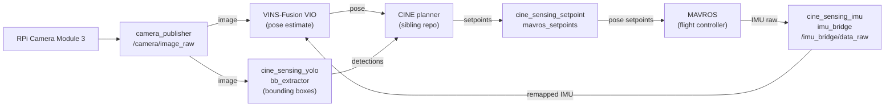

# CINE-Sensing

A Raspberry Pi 5 bolted to a drone, running a camera and IMU, doing real-time visual-inertial odometry, YOLO subject detection, and flight-controller bridging on commodity ARM hardware. This is the sensing half of the Cinematic Intelligent Navigation Engine. The [CINE trajectory planner](https://github.com/fishnos/CINE) is blind without it.

Four ROS 2 nodes handle the full perception loop: camera frames in, IMU axes reconciled with what VINS-Fusion expects, YOLO bounding boxes out, MAVROS setpoints in. Nothing exotic; no dedicated compute. The Pi is the point.

---

## Pipeline



---

## Quickstart

**Requires:** Ubuntu 24.04, ROS 2 Jazzy, Ceres 2.x + Eigen3 (via `rosdep`/`apt`).

```bash
# Deps
rosdep install --from-paths sensing_ws/src --ignore-src -r -y

# Build
source /opt/ros/jazzy/setup.bash
cd sensing_ws && colcon build --symlink-install && cd ..

# Source (sets ROS_DOMAIN_ID, venv, workspace)
source source_env.sh

# Download YOLO weights
python3 tools/download_models.py

# Launch camera node
ros2 launch cine_sensing_camera camera.launch.py
```

---

## Run

```bash
# Camera
ros2 launch cine_sensing_camera camera.launch.py

# IMU bridge (axis-transform, publishes /imu_bridge/data_raw)
ros2 launch cine_sensing_imu imu_bridge.launch.py

# Gyroscope serial publisher + VIO relay
ros2 launch cine_sensing_imu imu_publisher.launch.py

# YOLO bounding-box extractor
ros2 run cine_sensing_yolo bb_extractor

# Full VIO stack (camera + IMU bridge + VINS)
ros2 launch third_party/vins_fusion/vins/launch/complete_vio.launch.py
# Or via Python runner
python3 third_party/vins_fusion/vins/run_vins.py

# Setpoint processor (bridges CINE setpoints to MAVROS)
ros2 run cine_sensing_setpoint mavros_setpoints
```

---

## Configuration

`configs/json/` is the single source of truth for shared parameters (`camera.json`, `gyroscope.json`, `user_params.json`, `vins.json`). Edit values there; do not hard-code paths or constants in node source files.

---

## Open issue: VIO drift

IMU/camera drift is an active research problem on this hardware. Three candidate fixes exist (IMU axis remap in `imu_bridge.py`, MAVROS topic selection, noise model retuning) and none have been validated on hardware yet. The S5 refactor on `main` is representation-only, numerically identical to prior code.

See [`docs/2026-06-13-vio-drift-decision.md`](docs/2026-06-13-vio-drift-decision.md) for the full analysis.

> **Do not adopt any drift-fix variant without hardware validation.**

---

## Troubleshooting

**Missing model weights:** run `python3 tools/download_models.py`. Check `VERSION` matches a published release.

**`CINE_SENSING_ROOT` unset:** launch files fall back to a sentinel walk from `__file__`. Set the variable explicitly if path-resolution errors appear.

**IMU/VIO drift:** see [`docs/2026-06-13-vio-drift-decision.md`](docs/2026-06-13-vio-drift-decision.md) and the open-issue section above.

---

## Related

- [CINE](https://github.com/fishnos/CINE): trajectory optimization and planning
