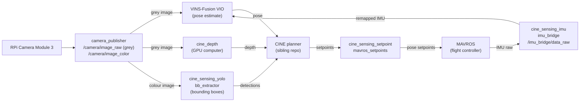

# How CINE-Sensing works

Visual-inertial odometry comes from
[VINS-Fusion](https://github.com/HKUST-Aerial-Robotics/VINS-Fusion) (HKUST Aerial Robotics
Group), through a ROS 2 port, kept in `third_party/vins_fusion/` with every change listed
in its [`UPSTREAM.md`](../third_party/vins_fusion/UPSTREAM.md). Its camera models are
[OpenVINS](https://github.com/rpng/open_vins)'s, detection uses
[Ultralytics YOLO](https://github.com/ultralytics/ultralytics), and MAVROS talks to the
flight controller. [`THIRD_PARTY_NOTICES.md`](../THIRD_PARTY_NOTICES.md) lists all bundled
code. This repository adds:

- the ROS 2 nodes in the `cine_sensing_*` packages: the camera publisher, the bridge
  that hands the flight controller's motion data to VINS, the YOLO detector node, and the
  relay that passes CINE's position targets to the flight controller;
- a detector setup for YOLO11n fine-tuned on the HomeObjects-3K dataset (12 kinds of
  household object); the trained weights are not published;
- camera calibration scripts in `tools/calibration/`;
- a VIO test harness: record one flight's sensor data once, replay it through every
  configuration, and compare drift on identical input (`tools/vio_ab_run.sh`,
  `third_party/vins_fusion/vins/tests/`);
- the configuration system in `cine_sensing_config/`, including profiles that swap in
  one set of camera or tuning values without editing the base files.

## Data flow

## Design notes

- A large depth model takes seconds per frame on the Pi's CPU, so depth runs on a
  separate computer with a GTX 1660 Ti, which receives the Pi's images over ROS 2 and
  sends depth back. The VIO launch file initiates depth on the Pi only when asked
  (`use_depth:=true`).
- VINS-Fusion's camera library (camodocal) is licensed CC-BY-SA 2.0, which cannot be
  combined with GPL-3.0 code. It was replaced with OpenVINS's camera classes, and
  `third_party/vins_fusion/camera_models/tests/` checks the new code against values
  camodocal produced before it was removed.
- VINS-Fusion uses part of the Ceres solver that was removed in Ceres 2.2, the version
  Ubuntu 24.04 ships, so `tools/install_ceres_2_1.sh` builds 2.1 from source.
- No two test flights move the same way, and so the harness records the sensor data once
  and replays the same recording through every configuration.
